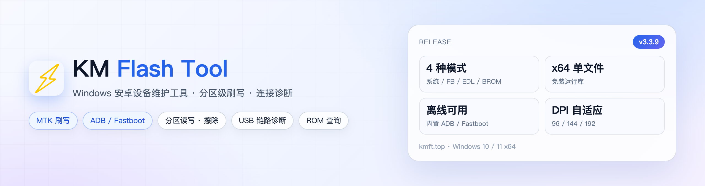
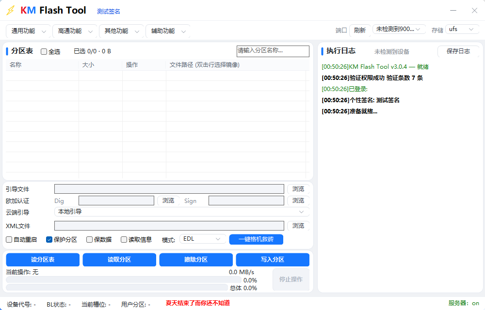
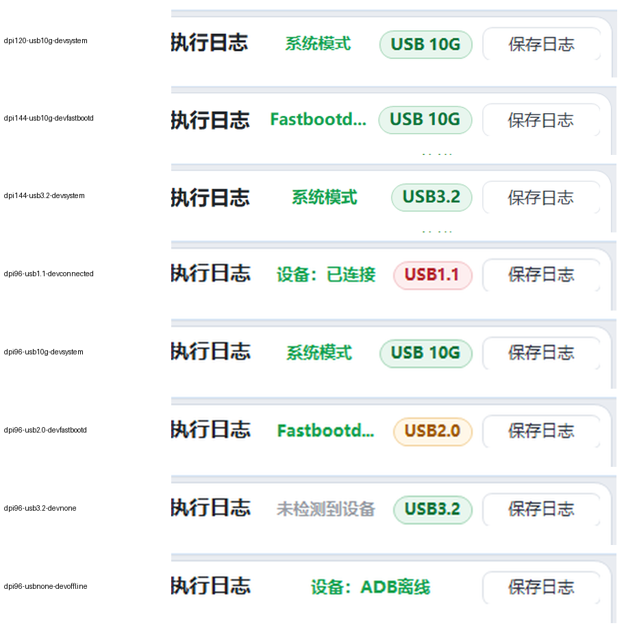
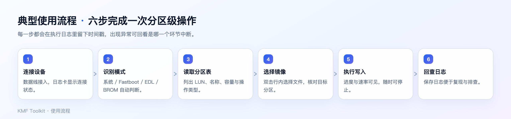

<p align="center">
  
</p>

<h1 align="center">KM Flash Tool · KMF Toolkit</h1>

<p align="center">
  Windows 上的安卓设备维护工具箱：连接诊断、分区级刷写、ADB / Fastboot 控制台、投屏、ROM 查询与日志回查。
</p>

<p align="center">
  <a href="https://github.com/zts10086/kmf-toolkit/releases"></a>
  <a href="https://github.com/zts10086/kmf-toolkit/releases"></a>
  
  <a href="LICENSE"></a>
  <a href="https://kmft.top/"></a>
  <a href="https://github.com/zts10086/kmf-toolkit/issues"></a>
</p>

<p align="center">
  <a href="#界面">界面</a> ·
  <a href="#功能">功能</a> ·
  <a href="#下载与安装">下载</a> ·
  <a href="#快速上手">上手</a> ·
  <a href="#架构">架构</a> ·
  <a href="#版本记录">版本记录</a> ·
  <a href="#常见问题">FAQ</a>
</p>

---

## 简介

**KM Flash Tool（KMF）** 是面向 Windows 的安卓设备维护工具。插上手机就能看到设备处在哪一种连接模式，读取分区表、按分区读写或擦除、打开 ADB / Fastboot 命令环境、把手机画面投到桌面、按机型查 ROM，并且把每一步操作都写进可导出的执行日志。

它的设计目标很朴素：**把"设备现在什么状态、我下一步该做什么"这件事讲清楚**。所有状态判断都收敛到界面右上角的日志卡，所有操作都从同一条工具链流出，出问题时能拿着日志复现。

- **面向机型维护**：系统模式 / Fastboot / EDL 9008 / MTK BROM 四种连接模式统一识别。
- **分区级操作**：读分区表、读分区、写分区、擦除分区，进度、速率、当前操作都在同一条任务条上。
- **离线可用**：ADB / Fastboot 工具链随程序提供，启动即释放，不依赖联网下载。
- **可回查**：每条日志带时间戳与结果标记，一键保存成文本。

> 当前发行版：**v3.3.9**（Windows x64）· 官网 [kmft.top](https://kmft.top/) · 许可证见 [LICENSE](LICENSE)

---

## 界面

<p align="center">
  
  <br>
  <sub>主界面：左侧分区表 + 任务条，右侧执行日志；标题栏集中显示设备状态与 USB 链路速率</sub>
</p>

设备状态不是一句"已连接"就完事。日志卡标题行会同时给出**连接模式**（系统模式 / Fastboot / EDL / BROM / ADB 离线 / 未检测到）和**当前 USB 链路速率**（USB 10G / USB3.2 / USB2.0 / USB1.1）。链路掉到 2.0 时刷写速度会明显下降，这个徽标就是提前告诉你"先换根线"。

<p align="center">
  
  <br>
  <sub>状态组合实测：96 / 144 DPI，USB 10G / 3.2 / 2.0 / 1.1，系统模式 / Fastboot / 离线 / 未检测到</sub>
</p>

<p align="center">
  
  <br>
  <sub>冷启动瞬间显示"正在检测设备"，避免把"还在识别"误读成"没连上"</sub>
</p>

---

## 功能

<p align="center">
  
</p>

| 想做什么 | 在哪里 | 说明 |
| --- | --- | --- |
| 看设备有没有连上 | 主界面 → 执行日志标题栏 | 四种连接模式 + USB 链路速率；异常时先看这里 |
| 排查 Windows 驱动 | 辅助功能 → 设备管理器 | 打开系统设备管理器，确认手机与驱动被识别 |
| 打开 ADB / Fastboot 命令环境 | 辅助功能 → adb命令 | 工具链随程序提供，断网也能用 |
| 把手机屏幕投到电脑 | 辅助功能 → 一键投屏 | 需要可用的 ADB 连接并完成授权 |
| 查机型对应的 ROM | 辅助功能 → rom查询 | 核对机型、版本、地区后再下载 |
| 找配套工具和文件 | 辅助功能 → 资源下载 | 分类资源列表，依赖网络与服务可用性 |
| 读 / 写 / 擦除分区 | 主界面 → 分区表 + 任务条 | 读分区表 → 勾选目标 → 选择镜像 → 执行 |
| 留下问题现场 | 执行日志 → 保存日志 | 导出文本，含时间戳与失败原因 |

<p align="center">
  
</p>

---

## 下载与安装

前往 **[Releases](https://github.com/zts10086/kmf-toolkit/releases)** 下载最新版：

| 文件 | 说明 |
| --- | --- |
| `KMF-Tool-3.3.9-x64.exe` | Windows x64 单文件程序，免安装 |
| `SHA256SUMS.txt` | 发布包校验值，下载后建议核对 |

```powershell
# 核对下载文件的 SHA-256（PowerShell）
Get-FileHash ".\KMF-Tool-3.3.9-x64.exe" -Algorithm SHA256
```

**运行环境**：Windows 10 / 11（x64）。程序为静态链接的单文件，无需额外安装运行库。

**首次运行**：从浏览器下载的 exe 可能被 SmartScreen 拦截，选择「更多信息 → 仍要运行」；若杀毒软件报未知程序，请把程序加入信任列表后再运行。程序不会修改系统目录，运行期文件释放到独立目录，退出后保留缓存以便下次秒开。

---

## 快速上手

1. **启动程序**，用支持数据传输的 USB 线连接手机。
2. **看日志卡**：出现 `系统模式` / `Fastboot` / `EDL` / `BROM` 即为识别成功；若显示 `未检测到设备`，先按 [常见问题](#常见问题) 排查线材、驱动与授权。
3. **读分区表** → 在分区列表中勾选目标分区 → 双击行内「文件路径」选择镜像 → 点「写入分区」。
4. 需要保存过程记录时，点日志卡右上角 **保存日志**。

> 刷写会改写设备分区。首次操作前请确认机型、分区名与镜像三者对应，重要数据先备份。

---

## 架构

<p align="center">
  
</p>

程序按四层拆分，界面层只负责呈现与编排，设备交互全部收敛到传输层：

- **交互层**：Win32 + 自绘界面，负责分区表、任务条、日志卡与状态徽标；同一份几何计算同时驱动绘制、命中测试与光标判定，DPI 变化等比缩放。
- **任务层**：把一次操作拆成可中断的步骤序列，统一向上回报进度、速率与最终结果（成功 / 失败 / 取消）。
- **传输层**：ADB、Fastboot、EDL 9008、MTK BROM（Sahara / Firehose）四类会话，各自独立，互不耦合。
- **资源层**：内嵌工具链（启动即解压、摘要校验通过则复用）、按需获取的云端资源与完整性校验。

关于设备状态判定、USB 链路速率识别与界面适配的细节，见 [docs/design-notes.md](docs/design-notes.md)。

---

## 版本记录

| 版本 | 类型 | 摘要 |
| --- | --- | --- |
| **v3.3.9** | 发行版 | ADB / Fastboot 工具链内嵌随程序释放，断网可用；启动进度条按文件推进；新增设备模式与 USB 链路速率徽标 |
| 3.4.x | 开发线 | 设备状态检测重构（冷启动预热、重试、ADB 离线单列、Windows 侧 USB 在线兜底） |

完整记录见 [CHANGELOG.md](CHANGELOG.md)，单版本说明见 [docs/release-notes/v3.3.9.md](docs/release-notes/v3.3.9.md)。

---

## 常见问题

<details>
<summary><b>显示"未检测到设备"怎么办？</b></summary>

按顺序排查：① 换一根**支持数据传输**的线（充电线常常没有数据线芯）；② 换 USB 口，优先直连主板后置口，避开 Hub；③ 打开「辅助功能 → 设备管理器」确认系统是否出现设备；④ 系统模式需在手机上开启 **USB 调试** 并点「允许」授权；⑤ Fastboot / EDL 模式需要对应驱动，系统模式可用不代表下载模式可用。
</details>

<details>
<summary><b>日志显示"设备：ADB离线"是什么状态？</b></summary>

设备物理上在线，但 adb 通道还没恢复（常见于换线瞬间、授权弹窗刚关闭、adb 服务重启）。等一两秒会自动恢复；一直离线请重新插拔并确认授权。
</details>

<details>
<summary><b>USB 徽标显示 USB2.0 / USB1.1，会影响刷写吗？</b></summary>

会。USB2.0 的理论上限远低于 USB3.x，大分区写入会明显变慢。徽标只做显示，出现 2.0/1.1 时优先检查线材、接口与 Hub。
</details>

<details>
<summary><b>写入失败 / 中途停止怎么办？</b></summary>

停止按钮会中断当前步骤，已完成的分区不会回滚。请保存日志，核对镜像与分区容量是否匹配，再重新读取分区表后重试。救砖类操作请先确认自己有机型的完整固件。
</details>

问题与建议请提交到 [Issues](https://github.com/zts10086/kmf-toolkit/issues)，附上**程序版本、手机型号、连接模式与日志文本**，便于定位。

---

## 使用范围

- 本程序用于**自有设备**的维护与刷写，请确认你对设备拥有处置权。
- 刷写、擦除、格式化会改动设备分区，操作前请自行备份；因误操作造成的设备异常由使用者自行承担。
- 本仓库仅发布**成品程序与使用文档**，不含源代码；程序与文档的再分发、反编译、二次打包请遵守 [LICENSE](LICENSE)。

---

## English

**KM Flash Tool** is a Windows toolbox for Android device maintenance: it detects how a phone is connected (system, Fastboot, EDL 9008, MTK BROM), reads and manages partitions, performs partition-level read / write / erase with live progress, ships ADB and Fastboot offline, and keeps a timestamped, exportable operation log. Download the Windows x64 build from [Releases](https://github.com/zts10086/kmf-toolkit/releases).

---

<p align="center">
  <sub>KMF Toolkit · <a href="https://kmft.top/">kmft.top</a> · 保持更新，保持可回查</sub>
</p>
